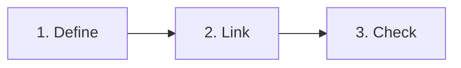

# ubiq

**Catch broken names before they confuse someone.**

Your docs say “session.” One page explains what that means. Ubiq checks that
links to “session” still lead to that definition, even as your project changes.
A typo, a missing definition, or two definitions with the same name? You get a
file, a line, and an error you can fix.

Think of it as a spell-check for your project's vocabulary.

## How it works

Give a word a home. Link to it. Let ubiq check the links.



You choose what the words mean. Ubiq checks that each explicit reference finds
exactly one definition. It also finds ordinary mentions, so you can see where
a word appears. No AI model is needed to run the checks.

## Start with your agent

Use the [apply-ubiq skill](skills/apply-ubiq/SKILL.md) to add ubiq to a project.
It walks through the setup with you:

1. Find the words and definitions your project already uses.
2. Resolve unclear meanings with you and add the checks.
3. Run `ubiq check` and add it to your automated checks.

Ask your agent:

> Read the [apply-ubiq instructions](skills/apply-ubiq/SKILL.md) and follow them
> for this project. Keep existing source files intact. Ask me about unclear terms.

These skills live in this repository. Give your agent this checkout or the linked
instructions. Installing the CLI alone does not install the skills.

When the project changes, use [maintain-ubiq](skills/maintain-ubiq/SKILL.md) to
find new terms, repair references, and check the result.

Prefer to do it yourself? Follow the steps below.

## Quick start with the CLI

You need Python 3.10 or later and Git. Run these commands in a terminal.

### 1. Install ubiq

```bash
python -m pip install 'git+https://github.com/Ltilak13/ubiq.git@v0.6.0'
```

### 2. Open your project and start

Replace `/path/to/your/project` with your project's folder.

```bash
cd /path/to/your/project
ubiq init
ubiq check
```

`init` creates the configuration. It keeps your existing source files intact.
Review the files it finds. If you already have `ubiq.yaml`, skip `init`.

### 3. Give a word a home

Create `.ubiq/glossary/session.md` with this text:

```markdown
---
term: session
---

A period of play.
```

This is a definition: a name at the top, its meaning below.

### 4. Use the word in your docs

Add this line to your project's `README.md`:

```markdown
Start a [session](.ubiq/glossary/session.md).
```

Then check it:

```bash
ubiq check
```

A passing check reports `0 errors`. Your link has a home.

### 5. See it catch a mistake

Change the link's destination from `session.md` to `sesion.md`. Run `ubiq check`
again. It reports `E002` at the broken reference. Fix the spelling and check again.

That's the same check you can run on every pull request.

## Keep your docs connected

| I want to… | Run this |
| --- | --- |
| Check references | `ubiq check` |
| List defined words | `ubiq terms` |
| Find uses of a word | `ubiq refs session` |
| Find possible new words | `ubiq candidates` |
| See why a file is included | `ubiq explain` |

For automated checks, use the [GitHub Action](action.yml) or the
[pre-commit hook](.pre-commit-hooks.yaml). The
[setup skill](skills/apply-ubiq/SKILL.md) helps wire them into your project.

## Go further

Keep the first setup small. Add these when your project needs them:

- [Repository discovery](docs/guide.md#repository-groups-and-schemas): find existing files and definitions.
- [Schema validation](docs/schema-validation.md): check required fields and relationships between records.
- [Composable skills](docs/guide.md#composable-skills): share instructions, inspect dependencies, and find repeated text.
- [Full guide](docs/guide.md): setup choices, reference rules, configuration, and all commands.
- [Contributing checks](docs/guide.md#pr-validation): test a change to ubiq itself.
- [Specification](docs/spec.md): exact rules and error codes.
