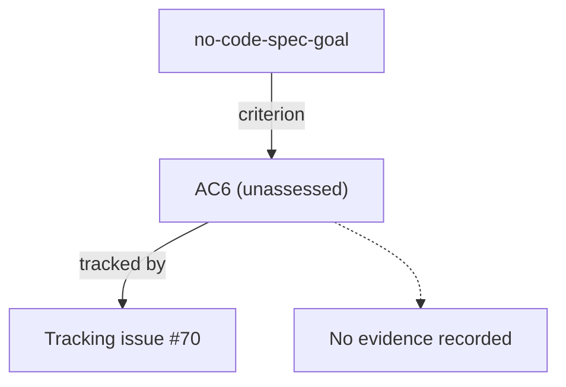

# Goal: no-code specs

This goal defines outcomes and acceptance evidence. It replaces the tracking
issue #64. It does not claim that Ubiq supports these outcomes today.
The sequence of work that proves the outcomes, with each step's issue and
blockers, is in [[plan:no-code-dogfood]] (issue #113).

The [[plan:no-code-spec-views]] plan tracks checked diagrams and tables.

## Objective

Let a repository use each Markdown record as its spec, its docs, and its tests
at once. Every check runs in CI with no agent. The rule underneath: each fact has
one home.

| Fact | Home | Checked by |
| --- | --- | --- |
| Values and contracts | Frontmatter | `ubiq check` (JSON Schema bindings), CUE for cross-field rules |
| Behavior | Gherkin scenarios in the record (`.feature.md`) | Cucumber, with generic steps |
| Rationale | Prose | Vale for writing rules, plus Ubiq's own checks |
| Diagrams | Generated from records, or checked against them | Ubiq (#59) |

Agents help write and maintain records. No check needs an agent to pass.

## Scope

Pre-commit hooks, CI, Vale, CUE, and Cucumber stay outside Ubiq. Ubiq documents
how to combine them as a recipe.

Out of scope: proving that prose is true. Ubiq makes risky sentences visible
(restated values, and claim-word rules in Vale) and moves facts into frontmatter
or scenarios. What remains is for review.

Tabled: a renderer for field references (PR #62). Checked links read well in
GitHub previews, so it is not needed now.

## Acceptance evidence

The goal is achieved when:

1. AC1: Each fact kind (values and contracts, behavior, rationale, and diagrams) has one home in a record, and a named check reads it there.
2. AC2: All checks (`ubiq check`, `cue vet`, `vale`, and `cucumber`) run in pre-commit and CI with no agent, following a documented recipe.
3. AC3: Prose cannot silently restate a frontmatter value. A restatement warns, a field link shows the value and fails when it is stale, and a field link can declare its field.
4. AC4: Spec criteria link to the Gherkin scenarios that test them, names inside configured fenced blocks are checked, and test results verify the criteria.
5. AC5: Controlled vocabulary lives in checkable records and exports Vale rules, so prose and step definitions use checked terms.
6. AC6: Ubiq's own features are records, and the adoption order derives from their declared dependencies.
7. AC7: A worked example repository applies this pattern, and all of its checks pass in CI.

AC6 evidence diagram

The view shows what AC6 tracks and what evidence its record cites. The issue
link tracks the work. The criterion's assessment records whether it holds.

<!-- ubiq:dogfood-diagram -->

<!-- /ubiq:dogfood-diagram -->

