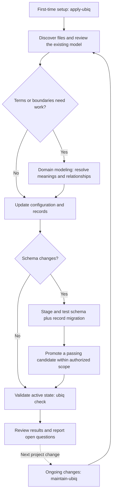

# Ubiq guide

[Back to the quick start](../README.md)

Setup details, configuration, and the full command reference.

## Apply ubiq to your project

Start with the language your team already uses. You can keep existing glossary
files and naming fields; ubiq can register them without changing their format.
Use `apply-ubiq` for adoption and `maintain-ubiq` for ongoing work. Both workflows
include the domain review and validation relevant to the change.



Start with [apply-ubiq](../skills/apply-ubiq/SKILL.md), then return to
[maintain-ubiq](../skills/maintain-ubiq/SKILL.md) as your project changes. Domain
modeling and validation are work inside these flows. The companion skills
described below can help with that work when installed.

### 1. Understand the domain

Read the existing `GLOSSARY.md`, or `GLOSSARY-MAP.md` when the project has
multiple contexts. Check important terms against real examples and the code.
If a word means different things in different parts of the project, resolve
that distinction before assigning namespaces. A folder named `billing` is a
clue to investigate, not proof of a separate domain.

The `domain-modeling` companion skill helps challenge fuzzy terms, test
relationships with concrete scenarios, and capture agreed definitions. It is
not bundled with ubiq. If it isn't installed, do that analysis directly with
your agent or team as part of setup or maintenance. An established glossary may
already give you what you need; a routine reference repair doesn't require
redesigning the model.

### 2. Set up the checks

Ubiq ships three agent skills: `apply-ubiq`, `maintain-ubiq`, and [upgrade-ubiq](../skills/upgrade-ubiq/SKILL.md).
Follow the [skill installation instructions](../README.md#install-the-skills),
or give your agent this checkout and ask it to follow the linked `SKILL.md`.

Start with `apply-ubiq`. It discovers existing files, reviews their vocabulary
and domain boundaries, and creates the configuration and supporting metadata.
Existing source files stay intact; overlays attach aliases and relationships
where needed. Setup finishes with a passing check and CI integration.

For a manual setup, follow the [quick start](#quick-start-with-the-cli) below.
`ubiq init` creates a starting configuration. Review its discoveries before
treating them as your domain model.

### 3. Validate as you work

Run `ubiq check` locally and in CI. A passing check means the configured
references and constraints pass. Domain modeling still requires reviewing
meaning, responsibilities, and relationships. Running `discover`, `check`, and
`candidates` alone does not complete that review.

If you need typed records or domain constraints, use the
[schema change workflow](schema-workflow.md): stage the schema and record
changes together, test affected records and invalid cases, then promote the
candidate by registering it in `ubiq.yaml`. The normal `ubiq check` must enforce
the promoted schema. Simple vocabulary linking needs no custom schema.
The optional `validate-change` companion skill can coordinate repository checks
for schema and migration changes. Without it, run those checks directly. The
required validation is the same either way.

For version changes, use [upgrade-ubiq](../skills/upgrade-ubiq/SKILL.md) to reconcile CLI, CI, and skill revisions.
It reviews compatibility and relevant new capabilities before maintenance continues.

### 4. Maintain the vocabulary

Use `maintain-ubiq` after adding concepts, renaming files, or changing how parts
of the project interact. It compares fresh discovery with registered records,
fixes errors, and reviews orphan terms and possible new vocabulary. Return to
domain modeling when a change exposes conflicting meanings or boundaries.

The maintenance report should say what changed, what was checked, and what
still needs a decision. Linking mentions inside existing prose is opt-in.
Commits and pushes are separate actions.

## Quick start with the CLI

Install from a local Ubiq checkout (Python 3.10 or later):

```bash
pip install -e /path/to/ubiq
```

Then initialize the repository you want to check:

```bash
cd /path/to/your/repo
ubiq init
ubiq check
```

Add a record at `.ubiq/glossary/session.md`:

```markdown
---
term: session
---

A period of play.
```

Reference it from your README with an ordinary Markdown link:

```markdown
Start a [session](.ubiq/glossary/session.md).
```

That link is a checked vocabulary reference. If the file disappears or no longer
defines a record, `ubiq check` fails with `E002` and the source location.
Link the first useful mention in a section and leave repeated mentions plain.
Those plain mentions still appear in `ubiq refs session`.

To find sections that skip the link, turn on the unlinked-mention warning:

```yaml
unlinked_mentions: warn       # W002, once per term per section; never fails the check
unlinked_except: [pr]         # terms that are ordinary words here ("PR")
```

Headings, historical docs, a term's own record, and overlay sidecars are not
reported. The [maintain skill](../skills/maintain-ubiq/SKILL.md) works through
these warnings.

Wiki-links remain available. A typo such as `[[sesion]]` reports:

```text
E002 unresolved reference [[sesion]] — no defining record. Did you mean [[session]]?
```

## Repository groups and schemas

`ubiq init` inspects the repository before it writes configuration. It registers
recognizable skills, rules, scripts, and hooks in separate arrays under
`.ubiq/catalogs/assets.json`. Existing naming fields stay in their source files.
Assets without a naming field get sidecar records whose paths mirror the source tree.
Initialization preserves source files and refuses to overwrite existing configuration or metadata paths.

The current schema proposals describe naming-field mappings and available metadata.
Opt-in [native schema validation](schema-validation.md) checks typed frontmatter,
structured inventories, record relationships, coverage, and evidence through `ubiq check`.
The broader goal is [domain-aware frontmatter and a knowledge tree](domain-schema-goal.md).

For setup or maintenance, inspect the current structure without writing files:

```bash
ubiq discover --json
```

The report groups assets by directory and proposes schemas from frontmatter.
Each schema identifies its files, naming field, available metadata fields,
namespace evidence, and whether it needs review. Mixed formats remain separate.
For example, a folder containing `term:` records and `title:` records gets two
schema proposals. Unknown naming fields remain unresolved for review.

Existing glossaries and directories under `src`, `packages`, `services`, `apps`,
`domains`, `contexts`, or grouped `glossary` folders supply context candidates. A directory name alone cannot
establish a domain boundary. The setup and maintenance skills check vocabulary,
ownership, and code dependencies before assigning domain namespaces. A single
context can keep one glossary. Established contexts can have separate glossary
folders and namespaces, with a map that preserves their relationships.

Discovery skips symlinks, common dependency/build directories, and configured
ignore patterns. It reports current files; `.ubiq/discovery.json` is only the
initialization snapshot. Generated catalog coverage checks registered records.
Use discovery during maintenance to find new files that have no record yet.

## References

- Inline Markdown links to registered records or paths matching configured
  glossary globs must resolve. The destination selects the record, so the label
  can be natural prose. Fragments and link titles are allowed. Other relative
  links must land on an existing file or directory; a missing one is `W007`, a
  warning that `references.link.severity` can raise or silence. URLs,
  anchor-only links (`#x`), root-relative paths (`/x`), and code are not
  checked, and links that leave an `edges.install` directory are left to
  `W004`. Path-shaped wiki-links (`[[MISSION.md]]`) are not checked. Full `[label][id]`, collapsed `[id][]`,
  and shortcut `[id]` links work with a single-line `[id]: path/to/record.md`
  definition. Labels ignore case and repeated whitespace; the first definition wins.
- Wiki-links such as `[[session]]` and `[[game:session]]` resolve by name, alias,
  or record ID. Qualify a name when multiple namespaces define it.
- Configured delimiters support slash-commands such as `/tdd`. With
  `only_known: true`, unknown names, including typos, are ignored.
- Configured ID patterns and frontmatter reference fields must resolve too.
  Plain mentions are indexed for search and never fail the check.

Each kind has a policy you can tune per repository: how severe its failures are
and which regions it scans besides plain prose (`inline_code`, `address`,
`comment`):

```yaml
references:
  id: {severity: warn}       # report unknown ids without failing the check
  delimiter: {severity: off} # keep /commands searchable, report nothing
  wiki: {scans: []}          # ignore [[links]] in URLs and HTML comments
```

Settings that would break a spec guarantee, such as scanning fenced code or
letting a plain mention fail the build, are rejected with `E008`. The
[spec](spec.md#reference-kinds) lists every kind's defaults.

Records use YAML frontmatter with `term`, optional `ns`, `aliases`, and `id`.
The body contains the definition. Existing schemas can use another term field,
including skill `name:` fields. Sidecar overlays attach metadata and dependencies
without editing the source files. Equivalent glossary globs register each file
once. Conflicting namespace or term-field rules report `E008`; two overlays
for one source report `E005` and must be consolidated.

An overlay can declare dependencies for an ordinary document such as `README.md`.
Include a field listed in `ref_fields`, such as `uses`, and omit term metadata
(`term`, `ns`, `aliases`, and `id`). An empty dependency list is valid.
The document stays outside the glossary, and each dependency must resolve.

## Commands and CI

```bash
ubiq check                             # exit 1 on errors, 0 otherwise
ubiq check --json                      # diagnostics for CI and agents
ubiq terms                             # list the glossary
ubiq terms --format context --ns repo   # emit a CONTEXT.md Language section
ubiq refs session                      # find links and ordinary mentions
ubiq refs game:session                 # restrict the query to a namespace
ubiq refs session --json               # structured definitions and references
ubiq refs session --kind explicit --kind markdown
ubiq discover --json                   # propose groups and schemas from source files
ubiq explain                          # show why files were discovered
ubiq explain --json                    # the same discovery evidence as JSON
ubiq candidates                        # marked names in 2+ docs with no record
ubiq candidates --json --min-files 3
ubiq graph skill:ship                  # invoke, include, and route edges from a record
ubiq graph part:checkout --callers     # who reuses a shared part
ubiq overlap --unit line               # prose that several records repeat
ubiq impact --since main              # changed records and the callers they affect
ubiq compare --since main --markdown  # new and resolved findings for a PR comment
ubiq coverage                          # how many selected files have typed metadata
ubiq coverage --since main --markdown  # coverage change and policies for a PR comment
```

`--kind` is repeatable: results include any selected kind (`explicit`, `id`,
`field`, `mention`, `catalog`, or `markdown`) or policy (`wiki` or `delimiter`,
the two halves of `explicit`). Without filters, `refs` includes all kinds. Its JSON output contains `query`, `definitions`, `references`, and
`count`; an unknown query returns an empty result with `error` and exits 1.
Paths inside the repository are relative to its root; external paths are absolute.

`explain` shows matching globs, followed links, overlays, and historical rules.
It reports ignored candidates encountered during discovery and globs with no
matching files. Every path setting shares one pattern language: patterns start at
the repository root, `**` enters dot-directories, and `**/node_modules/**` (a
default) ignores nested copies. An `ignore:` list you set replaces the defaults,
so keep the ones your repository still needs. It doesn't search other directories just to explain exclusions.
The JSON output distinguishes files selected for discovery from documents actually
scanned. Use `check` to validate references; `explain` reports discovery and
assembly errors. Invalid configuration reports `E008` instead of a traceback.

`candidates` lists possible missing terms: inline-code spans that are a whole
hyphenated lowercase identifier (`ready-for-agent`), match no term or alias, and
appear in at least `--min-files` live docs (default 2). If your docs bold their
terms (`**tracer bullet**`), set `candidate_shapes: [code, bold]` to report bold
names too. Bold is off by default because most bold text is emphasis. It reads
the same docs as `check`, minus historical ones, and never writes. Deciding what
becomes a record or an alias is left to the
[maintenance skill](../skills/maintain-ubiq/SKILL.md).

Use the bundled GitHub Action (`uses: Ltilak13/ubiq@main`) or the
[pre-commit](https://pre-commit.com) hook in `.pre-commit-hooks.yaml`; Markdown, YAML, and JSON changes trigger it.
The [integration skill](../skills/apply-ubiq/SKILL.md) covers setup in another repo.

`coverage` measures typed metadata over the files a `coverage:` section
selects. List the asset families you own, give every exclusion a reason, and
add `min_typed_percent` or `no_regression` to gate CI. A file counts as typed
when a schema binding selects it or an `x-ubiq` record names it as source;
registering it as vocabulary is not enough. When the report shows a gap, add a
schema rather than an exclusion. Run it in CI with full history
(`fetch-depth: 0`) and `--since` the pull request base, next to `ubiq check`,
which stays the validation gate. This repository's `ubiq.yaml` and CI workflow
are a working example; the [spec](spec.md#coverage) has the full contract.

The [spec](spec.md) defines the resolution rules and diagnostics, including
catalog checks and historical-document exceptions. Ubiq checks its own docs.

## PR validation

Install the development dependencies and run the local checks before publishing:

```bash
python -m pip install -e ".[dev]"
python -m mypy
ruff check src tests
python -m pytest tests/ -q
ubiq check
python -m pip check
```

Mypy checks all production modules, including bodies without annotations, against
Python 3.10. This is a gradual typing baseline; it does not require every function
to have annotations. Tool and stub versions are pinned in `pyproject.toml`.

CI also runs actionlint 1.7.12 on the workflows, tests Python 3.10 through 3.14
on Linux and Python 3.14 on macOS, builds and validates the source archive and
wheel, tests a clean wheel installation, and exercises the bundled GitHub Action.
For local workflow validation, install actionlint 1.7.12 and run `actionlint`.

The required checks for `main` are recorded in
[branch-protection.json](../.github/branch-protection.json). They require successful
GitHub Actions results on a branch that is up to date with `main`, including for
administrators. Keep the check names in that file aligned with the workflow.
An administrator can apply the settings with:

```bash
gh api --method PUT repos/Ltilak13/ubiq/branches/main/protection \
  --input .github/branch-protection.json
```

This command replaces branch protection settings. Review any existing protection
before applying it; the file does not require review approvals or restrict pushes
to particular users or teams.

## Roadmap

The current focus is deterministic checks: readable Markdown, consistent
resolution, and errors that explain how to fix a broken reference.

Later options include a code-symbol map, advisory semantic checks, external-doc
adapters, and editor navigation. Each needs useful results on real repositories
before it becomes a required check.

## Composable skills

Register shared parts as records so skills include them by link instead of
copying them:

```yaml
glossary:
  - {glob: "skills/*/SKILL.md", term_field: name, ns: skill}
  - {glob: "skills/*/parts/*.md", term_field: name, ns: part}
ref_fields: [uses, routes, references]
edges:
  invoke: {blocked_by: disable-model-invocation}  # W003 for an edge the model can't follow
  route: {fields: [routes]}                       # "not for X; use Y" is not a dependency
  reference: {fields: [references]}               # informational examples and comparisons
  install: ["skills/*/SKILL.md"]                  # W004 for links that break once installed
  external: [../upstream-skills]                  # another repository installed into the same root
  drift: {ns: [skill]}                            # W005 when references and edges disagree
```

`uses` declares invoke edges, `routes` declares route edges, and a link to a
`part:` record is an include edge. `references` declares informational relationships
for examples, comparisons, and caller descriptions. These targets must resolve,
but graph walks do not follow them as dependencies. Installers copy or link only skill
directories, so keep a part in `parts/` inside the skill directory that owns its
subject: a `../<skill>/parts/` link then resolves in the source tree and once
installed. A part can list enumerated inputs, such as `inputs: {mode: [new,
existing]}`; each include then names one after the link, as in ``Follow
[checkout](../ship/parts/checkout.md) in `new` mode.`` (E012 otherwise).

`ubiq graph` shows all four kinds, `ubiq overlap` finds text worth extracting,
and `check` reports include cycles (E011). The
[composable skills goal](composable-skills-goal.md) covers what is still open.
