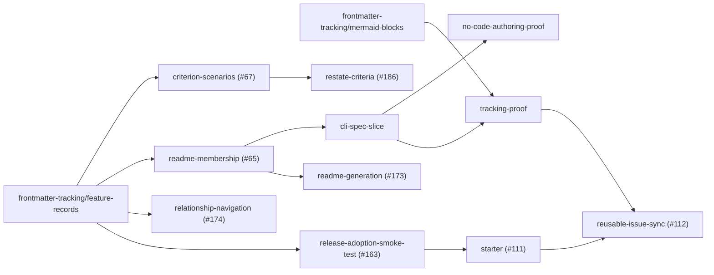

# Plan: no-code dogfood

This plan sequences issue #113: prove the no-code workflow in ubiq before
packaging it for other repositories. The [no-code specs goal](../goals/no-code-spec-goal.md)
owns the outcome and the acceptance criteria. This record owns the order, the
blockers, and the branch and pull request of each step, so an agent can check out
the repository and pick up the next step.

The plan is `proposed`: `ubiq sync github` mirrors nothing for it. Set it to `active`
to create issues for the steps that have none (`cli-spec-slice`,
`no-code-authoring-proof`, and `tracking-proof`) as sub-issues of #113.

## Steps

Three steps this plan depends on are defined once, in the
[frontmatter tracking plan](frontmatter-tracking.md), and required here by their
qualified names: `frontmatter-tracking/plan-records` added this plan (#124),
`frontmatter-tracking/feature-records` modeled the features (#70), and
`frontmatter-tracking/mermaid-blocks` is the generated Mermaid drift check (#59).

- `criterion-scenarios`: goal criteria accepted by tagged Gherkin scenarios and met only
  when those scenarios pass on `main`; the composable knowledge goal is the pilot (#67).
- `restate-criteria`: restate the other goals' criteria as scenarios, keeping judged
  criteria only where no scenario can accept them (#186).
- `release-adoption-smoke-test`: install the built wheel and verify that `ubiq plan --next`
  advances after one adoption step (#163).
- `readme-membership`: the README membership check (#65). It needs the feature
  relationships and can proceed independently of the Mermaid check.
- `readme-generation`: generate the managed feature list from checked frontmatter after
  the membership checks ship (#173).
- `relationship-navigation`: use fixture feature and release records to check both ways
  through one declared relationship. Check lookup behavior separately from diagram or list
  drift. This follow-up supports AC10 of the [composable knowledge goal](../goals/composable-knowledge-goal.md#acceptance-evidence) (#174).
- `starter`: ship the versioned goal and feature starter (#111) as soon as the release
  smoke test passes, and try it on a second repository. It comes before the tracking proof
  so that an outside adoption tests the record shapes while they are still cheap to change.
- `cli-spec-slice`: convert one real CLI behavior and its acceptance scenarios into a
  Markdown spec, with the README membership check as the first slice. Reuse a test
  binding that builds a small repository, runs `ubiq check`, and asserts the diagnostic
  and exit status in CI. Lower-level Python tests keep the parser and engine edge cases.
- `no-code-authoring-proof`: change the expected behavior in the spec first. Capture the
  new scenario failing against the old CLI and passing after the change, and cite both CI
  runs on the criterion. Where the engine already supports the rule declaratively, also
  show a rule change that takes effect through records alone.
- `tracking-proof`: a documentation and tracking pull request that changes the feature
  summary and prerequisite through records. Show CI flagging the stale README and Mermaid
  views, refresh both, and verify the checks pass without Python or workflow edits. Record
  a reviewed assessment and verify that the linked issue closes on merge, and capture a
  case where missing review leaves the issue open.
- `reusable-issue-sync`: make the issue sync reusable in consumer repositories (#112),
  using what the starter and the tracking proof found.

## How to read the steps

`requires` names the steps that must finish first; `<plan>/<step>` names a step of
another plan. `pr` is the pull request that
implements the step, once it is open. Workflow status is not stored here: an open pull
request means the step is in review, and a merged one means it is done. Record the current
blocker, next action, and evidence for a step in the pull request that changes them.

Dependency diagram

Arrows point from prerequisites to the steps they unlock. Ticketed steps link
to their GitHub issues. Refresh this view with
`python scripts/dogfood_diagrams.py --write`.

<!-- ubiq:dogfood-diagram -->

<!-- /ubiq:dogfood-diagram -->

